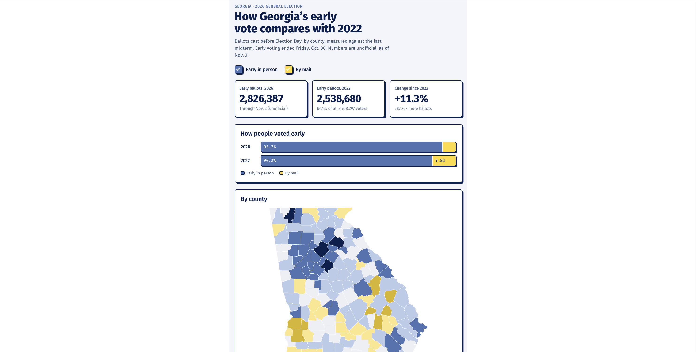

# Georgia's 2026 Early Vote vs. 2022

An interactive county map comparing early voting in Georgia's 2026 general election with the 2022 midterm, published by [Saporta Report](https://saportareport.com/how-georgias-2026-early-vote-numbers-compare-with-2022-dashboard/columnists/mark-lannaman/).

## What it shows

- Statewide early ballots in 2026 vs. 2022, with the percent change
- How early voters cast their ballots each year (early in person vs. by mail)
- A county map of the change in early ballots since 2022, with hover details for each county
- How this year's early voters voted in 2022: early, on Election Day, or not at all
- A sortable table of all 159 counties

Readers can toggle in-person and mail ballots on or off, and the totals, map and table update.

The comparison is midterm to midterm on purpose. Presidential years have much higher turnout, so comparing with 2024 would make 2026 look weak for reasons that have nothing to do with this election.

## Key findings (unofficial, as of Nov. 2, 2026)

- **2,826,387 early ballots in 2026 vs. 2,538,680 in 2022**, up 11.3% (287,707 more). That's a record for a Georgia midterm.
- **Early in-person voting rose 18.1%, while mail ballots fell 51.1%** (121,275 vs. 248,249).
- **Early voting rose in 109 counties and fell in 50**, mostly smaller rural counties in south and southwest Georgia. Stewart County fell the most, about 18%. The five core metro counties all grew: Gwinnett 23.7%, Clayton 16.1%, Cobb 14.6%, DeKalb 12.3% and Fulton 10.7%.
- **About 636,000 early voters (22.5%) didn't vote in Georgia's 2022 general election.** That group includes people who sat out the midterm, plus people who moved to Georgia or became eligible to vote since then.

## Data

All data comes from the Georgia Secretary of State.

- **2022 Voter history file, Nov. 8, 2022 general:** The state's final record of who voted and how (early in person, mail or Election Day) |
- **2026 Voter history file, Nov. 3, 2026 general:** One row per early ballot, with its status (accepted, rejected, etc.) |
- **Map boundaries:** U.S. Census Bureau, via the [us-atlas](https://github.com/topojson/us-atlas) package

## Method

- **2022 early votes:** voters in the 2022 voter history file marked as voting absentee, which in Georgia covers both early in-person and mail ballots, counted by county.
- **2026 early votes:** accepted ballots only (rejected, cancelled and spoiled ballots are excluded), one per voter, counted by county.
- **Mail** includes ballots sent electronically to military and overseas voters.
- **The 2022 vote-history split** matches each 2026 early voter to the 2022 voter history file by voter registration number, a permanent statewide ID.

## Verification

- **County spot-check:** 10 randomly chosen counties were recounted using a different method: the state's separate per-county files for 2026, and the raw voter history file for 2022. All 20 numbers matched exactly.
- **Voter-match spot-check:** 2,000 randomly sampled 2026 early voters were looked up individually in the 2022 file. The results were within a point of the full count.
- **Outside checks:** county counts match the Secretary of State's turnout dashboard, and the 2022 vote-history split lines up with NBC News/TargetSmart's published figures.

- **Code** (Python data processing, D3.js map and page) written with AI assistance (Claude)
